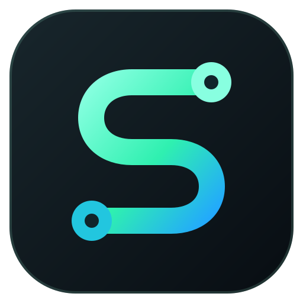
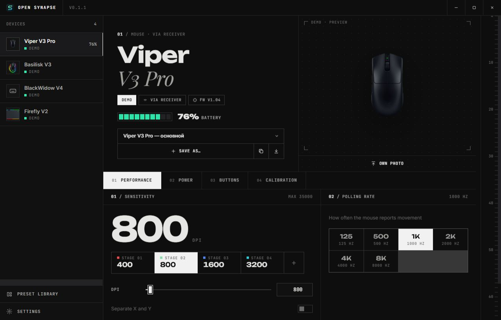

<p align="center">
  
</p>

<h1 align="center">Open Synapse</h1>

<p align="center">
  A free, open-source configurator for Razer peripherals.<br>
  Local settings. No account, cloud or telemetry.<br>
  <a href="#english">English</a> · <a href="#зачем">Русский</a> · <a href="https://github.com/1apok/open-synapse/releases/latest">Download</a> · <a href="https://github.com/1apok/open-synapse/issues">Report a device or bug</a>
</p>



*Screenshot from demo mode. Device support varies; see the hardware notes below.*

**Try it:** download the latest release for **Windows x64**, **Linux x64** or **macOS Apple Silicon**. Demo mode lets you explore the UI without a device. Close official Razer Synapse before configuring hardware.

**Early release:** Viper V3 Pro is the main hardware-tested mouse. The model database is not a promise that every feature works on every listed device. This is an independent MIT-licensed project, not affiliated with Razer.

---

## Зачем

Официальный софт требует вход в аккаунт, тянет фоновые сервисы и весит сотни мегабайт.
Open Synapse — это одно маленькое приложение (~10 МБ) на Rust, которое сразу открывается и просто настраивает устройство.

## Возможности

- **Производительность** — до 5 уровней DPI, раздельные X/Y, частота опроса 125–1000 Гц и HyperPolling до 8000 Гц.
- **Подсветка** — статичный цвет, дыхание (1 или 2 цвета), спектр, волна, реакция, звёзды; яркость, скорость, направление, отдельные зоны (логотип, колесо и т.д.) с живым превью.
- **Питание** — заряд и статус зарядки, время до сна, порог экономии заряда, режим индикатора донгла.
- **Кнопки** — колесо и боковые кнопки на любую функцию мыши или клавишу (с Ctrl/Shift/Alt/Win). Левая и правая не переназначаются, чтобы пресет не оставил без клика.
- **Калибровка** — расстояние отрыва (низкое/среднее/высокое), динамическая чувствительность с кривыми «классическая», «естественная», «прыжок» и своей.
- **Спящая мышь** — если беспроводная мышь уснула, приложение это видит и не принимает донгл за мышь.
- **Пресеты, которые переносятся** — пресет не привязан к модели: примените настройки одной мыши к другой, экспортируйте в файл `.osp` или поделитесь кодом `OSP1.…` в чате. Неподдерживаемые параметры просто пропускаются, DPI подрезается под максимум сенсора.
- **Автоприменение** — пресет устройства восстанавливается при каждом подключении.
- **Горячее подключение** — устройства появляются и исчезают сами.
- **7 тем**: Графит, Неон, Оранж, Ультрафиолет, Терминал, Бумага и честная **Windows 95** с объёмными кнопками.
- **Своё фото устройства** — перетащите картинку на превью (например, с сайта производителя); хранится только локально.
- **Настройки из памяти устройства** — DPI-уровни, частота опроса и время сна, сохранённые в мыши другой программой, считываются при первом подключении.
- **Русский и английский интерфейс**, шрифты Unbounded, Inter, JetBrains Mono и Playfair Display.
- **Демо-режим** — осмотреться без железа.

## Поддерживаемые устройства

В базе 70+ моделей: мыши (DeathAdder, Viper, Basilisk, Naga, Cobra, Orochi), клавиатуры (BlackWidow, Huntsman, Ornata, Cynosa), кейпады Tartarus/Orbweaver, коврики Firefly/Goliathus/Strider, док-станции и подставки. Полный список — в [`src-tauri/src/razer/models.rs`](src-tauri/src/razer/models.rs).

Устройство, которого нет в базе, всё равно определяется: возможности угадываются по его Product ID, а в интерфейсе оно помечено «Не проверено».

> Для BlackShark V2 Pro (PID `0555`) доступны пресеты эквалайзера «Игра», «Кино» и «Музыка». Остальные гарнитуры пока не поддерживаются; это не полная замена их настроек в Synapse.
> Перед запуском закройте Razer Synapse, если он установлен: два конфигуратора мешают друг другу.

## Установка

Скачайте установщик со страницы [Releases](../../releases). Сборки для Windows, Linux и macOS делаются автоматически при публикации тега `v*`.

На Linux для доступа к устройствам без root добавьте udev-правило:

```bash
echo 'SUBSYSTEM=="hidraw", ATTRS{idVendor}=="1532", MODE="0666"' | sudo tee /etc/udev/rules.d/99-open-synapse.rules
```

## Сборка из исходников

Нужны [Rust](https://rustup.rs), [Node.js](https://nodejs.org) 20+ и, на Windows, Visual Studio Build Tools с компонентом C++.

```bash
npm install
npm run dev      # запуск в режиме разработки
npm run build    # установщик в src-tauri/target/release/bundle
```

Тесты протокола: `cargo test --manifest-path src-tauri/Cargo.toml`.

Проверка интерфейса (два языка, семь тем, четыре размера окна, пресеты и прокрутка):

```bash
npx playwright install chromium
npm run test:ui
```

Изменения версий: [CHANGELOG.md](CHANGELOG.md).

## Как это устроено

```
src/                 интерфейс: HTML + CSS + JS без сборщика
  app.js             состояние, пресеты, горячее подключение
  art.js             SVG-иллюстрации устройств с зонами подсветки
  i18n.js            переводы
src-tauri/src/
  main.rs            команды Tauri, хранилище, импорт/экспорт
  razer/protocol.rs  90-байтовые HID feature-репорты Razer
  razer/models.rs    база устройств
  razer/mod.rs       поиск интерфейса управления и команды
```

Протокол — это 90-байтовые feature-репорты HID (класс команды, ID, аргументы, XOR-контрольная сумма), задокументированные проектом [OpenRazer](https://github.com/openrazer/openrazer). Для каждого устройства приложение перебирает его HID-интерфейсы и transaction ID, пока устройство не ответит, и запоминает рабочую пару.

Пресеты хранятся в `library.json` в папке настроек приложения (`%APPDATA%\dev.opensynapse.app` на Windows).

### Формат пресета

```json
{
  "format": "open-synapse/preset",
  "version": 1,
  "name": "Турнир",
  "kind": "mouse",
  "settings": {
    "dpi": { "stages": [{ "x": 800, "y": 800 }, { "x": 1600, "y": 1600 }], "active": 0, "split": false },
    "polling": 1000,
    "lighting": { "brightness": 80, "sync": true, "zones": { "all": { "effect": "static", "colors": ["#2ff0b0", "#22a6ff"], "two": false, "speed": 2, "direction": 1 } } },
    "power": { "idle": 300, "lowBattery": 15 }
  }
}
```

### Проверено на железе

Всё в разделах «Кнопки», «Калибровка» и «Индикатор донгла» снято с USB-трафика официального приложения (USBPcap) на **Viper V3 Pro** и перепроверено на самой мыши: значение записывается, читается обратно и возвращается. Для остальных моделей эти функции пока выключены. Чтобы добавить модель, сделайте то же: запишите трафик и приложите расшифровку к pull request.

Тесты на реальном устройстве помечены `#[ignore]` и запускаются явно:

```bash
cargo test --manifest-path src-tauri/Cargo.toml probe_hardware -- --ignored --nocapture
```

## Участие

Нашли устройство с неверными данными или хотите добавить новое — откройте pull request с правкой в `models.rs` (PID, transaction ID, зоны). Особенно полезны отчёты «работает / не работает» с реальным железом.

## Правовое

Open Synapse — независимый проект, не связанный с Razer Inc. Razer, Synapse и названия устройств — товарные знаки их владельцев и используются только для указания совместимости. Лицензия — [MIT](LICENSE).

---

<a id="english"></a>

## English

Open Synapse is a tiny (~10 MB) Rust + Tauri app that configures Razer devices with no account, cloud or telemetry.

- DPI stages (up to 5, split X/Y), polling rate up to 8000 Hz
- Lighting effects per zone with a live preview, brightness, speed, direction
- Battery, sleep timer and low-battery threshold for wireless devices
- **Portable presets**: apply any preset to any device, export `.osp` files or share `OSP1.…` codes
- Auto-apply on connect, hot-plug, Russian and English UI

Build: `npm install && npm run build`. Devices are listed in `src-tauri/src/razer/models.rs` — PRs welcome.
Not affiliated with Razer Inc. MIT licensed.
